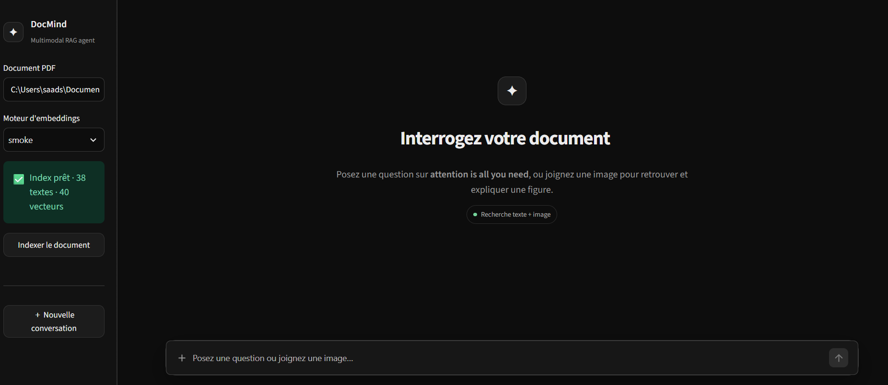
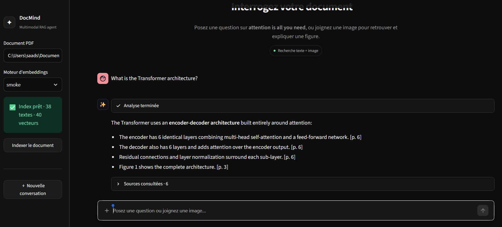
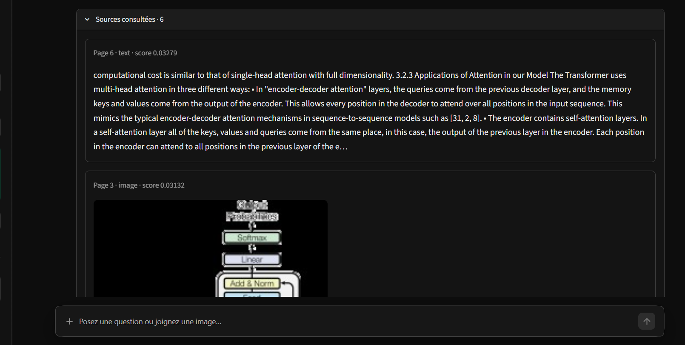

# DocMind — Agent RAG multimodal pour documents PDF


## Présentation du projet

DocMind est une application **RAG multimodale et agentique** conçue pour transformer un document PDF en une base de connaissances interrogeable. Contrairement à un chatbot classique, l’agent ne répond pas seulement à partir des connaissances générales d’un modèle de langage : il recherche d’abord les informations utiles dans le document fourni, puis génère une réponse fondée sur ces sources.

Le terme **RAG** signifie *Retrieval-Augmented Generation*, ou génération augmentée par la recherche. Cette méthode associe deux opérations :

1. **Retrieval** : retrouver dans le PDF les passages et les images les plus proches de la question.
2. **Generation** : transmettre ces éléments à un modèle de langage afin de produire une réponse claire, contextualisée et accompagnée de références.

Le système est **multimodal**, car il traite deux types de contenu :

- le texte extrait des différentes pages du PDF ;
- les images, schémas, graphiques et figures présents dans le document.

Il est également **agentique**, car un agent construit avec LangGraph contrôle le déroulement de la requête. Il analyse la question, appelle l’outil de recherche multimodale, observe les résultats obtenus et construit ensuite la réponse finale. Cette organisation suit le principe **ReAct** : *Reasoning → Action → Observation*.

Le projet utilise l’article scientifique *Attention Is All You Need* comme document de démonstration. L’agent peut notamment expliquer l’architecture du Transformer, retrouver une figure, comparer la self-attention aux réseaux récurrents ou rechercher une valeur dans les tableaux de résultats.

## Objectif

L’objectif principal est de permettre à un utilisateur d’explorer un document scientifique sans devoir parcourir manuellement toutes ses pages. Depuis une interface conversationnelle, il peut :

- poser une question en langage naturel ;
- obtenir une réponse basée sur le contenu réel du document ;
- joindre une image afin de retrouver une figure visuellement proche ;
- consulter les passages et les images utilisés par l’agent ;
- vérifier les numéros de page et les scores de similarité associés aux résultats.

## Fonctionnement général

Lors de l’indexation, DocMind calcule d’abord l’empreinte SHA-256 du PDF. Cette empreinte identifie de manière unique le document et évite les réindexations inutiles. PyMuPDF extrait ensuite le texte et les images page par page.

Le texte est découpé en fragments avec un léger chevauchement afin de préserver le contexte entre deux passages. Chaque fragment reçoit un embedding textuel. En parallèle, OpenCLIP transforme les textes et les images en vecteurs appartenant au même espace latent. Les vecteurs sont normalisés puis stockés dans des index FAISS avec leurs métadonnées : page, type de contenu, texte, légende et chemin de l’image.

Lorsqu’une question est envoyée, l’agent suit le cycle suivant :

1. Il interprète la demande de l’utilisateur.
2. Il transforme la question ou l’image jointe en vecteur.
3. Il interroge les index FAISS par similarité cosinus.
4. Il récupère les passages et figures les plus pertinents.
5. Il utilise ces résultats comme contexte pour générer la réponse.
6. Il affiche la réponse, les pages consultées, les images retrouvées et le déroulement de l’agent.

## Fonctionnalités principales

- Extraction du texte du PDF avec conservation des numéros de page.
- Découpage du contenu en fragments adaptés à la recherche sémantique.
- Extraction et sauvegarde des figures contenues dans le document.
- Embeddings textuels et embeddings multimodaux texte-image.
- Normalisation des vecteurs et indexation locale avec FAISS.
- Recherche par texte, par image ou de manière hybride.
- Agent ReAct construit avec LangGraph.
- Réponses sourcées avec pages, scores et aperçus des figures.
- Interface conversationnelle sombre et responsive avec Streamlit.
- Fonctionnement avec l’API OpenAI ou avec un modèle local FLAN-T5.
- Gestion des réindexations grâce à l’empreinte SHA-256 du document.

## Technologies utilisées 

| Technologie | Rôle dans le projet |
|---|---|
| **Python** | Langage principal utilisé pour développer le pipeline RAG, l’agent, la recherche et l’interface. |
| **Streamlit** | Fournit l’interface web conversationnelle, le chargement d’images, l’affichage des réponses et la consultation des sources. |
| **PyMuPDF** | Lit le PDF et extrait le texte, les images, les numéros de page ainsi que les informations nécessaires à la création des fragments. |
| **Sentence Transformers** | Génère des embeddings sémantiques précis pour les fragments textuels avec le modèle `all-MiniLM-L6-v2`. |
| **OpenCLIP** | Projette le texte et les images dans un espace vectoriel commun grâce au modèle `ViT-B-32`, ce qui rend possible la recherche multimodale. |
| **FAISS** | Stocke et interroge efficacement les vecteurs afin de retrouver les contenus les plus similaires à la requête. |
| **LangGraph** | Orchestre l’agent, ses états et le cycle ReAct entre raisonnement, appel de l’outil et observation des résultats. |
| **FLAN-T5 Base** | Génère localement une réponse à partir des passages retrouvés lorsqu’aucune clé OpenAI n’est configurée. |
| **API OpenAI** | Peut remplacer le modèle local pour produire les réponses finales avec un modèle distant. Son utilisation est facultative. |
| **Pillow** | Valide et traite les images PNG, JPG et WebP envoyées dans l’interface. |
| **NumPy** | Manipule et normalise les vecteurs numériques utilisés pendant l’indexation et la recherche. |
| **Typer et Rich** | Fournissent les commandes en ligne de commande et un affichage lisible des résultats dans le terminal. |
| **uv** | Crée l’environnement virtuel, installe les dépendances et garantit une installation reproductible grâce au fichier de verrouillage. |

## Architecture du système

```mermaid
flowchart LR
    A[Document PDF] --> B[Extraction PyMuPDF]
    B --> C[Fragments de texte]
    B --> D[Images et figures]
    C --> E[Sentence Transformers]
    C --> F[OpenCLIP]
    D --> F
    E --> G[(Index FAISS texte)]
    F --> H[(Index FAISS multimodal)]
    Q[Question ou image] --> I[Agent LangGraph / ReAct]
    I --> J[Retriever multimodal]
    J --> G
    J --> H
    G --> K[Contextes pertinents]
    H --> K
    K --> I
    I --> L[Réponse sourcée]
```



Le système sépare les responsabilités en deux parties :

- **MIND** : le modèle de langage analyse la question, décide d’utiliser l’outil de recherche et formule la réponse.
- **BODY** : le retriever interroge les index vectoriels et renvoie les passages ou figures les plus proches.

## Aperçu de l’application

### Interface principale

L’écran d’accueil permet de sélectionner le PDF et le moteur d’embeddings, d’indexer le document et de commencer une nouvelle conversation.



### Réponse générée avec citations

Après la recherche, DocMind synthétise les informations retrouvées et ajoute les pages correspondantes afin que l’utilisateur puisse vérifier la réponse.



### Consultation des passages et figures retrouvés

La section des sources permet d’inspecter les fragments textuels, les figures, leur page d’origine et leur score de similarité.



## Prérequis

- Windows 10 ou Windows 11.
- Python 3.11, 3.12 ou 3.13.
- Une connexion Internet lors du premier lancement afin d’installer les dépendances et télécharger les modèles.
- `uv`, le gestionnaire de paquets Python.

Installation de `uv` dans PowerShell :

```powershell
powershell -ExecutionPolicy ByPass -c "irm https://astral.sh/uv/install.ps1 | iex"
```

## Installation et lancement rapides

### Option 1 — Lanceur Windows

Clonez le dépôt puis ouvrez son dossier :

```powershell
git clone https://github.com/VOTRE-UTILISATEUR/VOTRE-DEPOT.git
cd VOTRE-DEPOT
```

Double-cliquez ensuite sur :

```text
LANCER_APP.bat
```

Le lanceur crée automatiquement l’environnement virtuel, installe les dépendances nécessaires et démarre DocMind.

### Option 2 — Depuis PowerShell

```powershell
cd "C:\chemin\vers\multimodal-rag-agent"
Set-ExecutionPolicy -Scope Process Bypass
.\LANCER_APP.ps1
```

L’application est ensuite accessible à l’adresse suivante :

```text
http://localhost:8501
```

Pour arrêter le serveur, utilisez `Ctrl+C` dans PowerShell.

## Installation manuelle

```powershell
uv sync --extra models --extra ui --extra dev
.\.venv\Scripts\streamlit.exe run app.py --server.headless false
```

## Configuration

La clé OpenAI est facultative. Sans clé, DocMind utilise le générateur local configuré dans `.env.example`.

Pour personnaliser la configuration, copiez le fichier d’exemple :

```powershell
Copy-Item .env.example .env
```

Exemple de configuration :

```dotenv
OPENAI_API_KEY=
OPENAI_MODEL=gpt-4.1-mini
MMRAG_PROFILE=production
MMRAG_TEXT_MODEL=sentence-transformers/all-MiniLM-L6-v2
MMRAG_CLIP_MODEL=ViT-B-32
MMRAG_CLIP_PRETRAINED=laion2b_s34b_b79k
MMRAG_DEVICE=auto
MMRAG_LOCAL_LLM=google/flan-t5-base
```

## Utilisation

1. Indiquez le chemin du document PDF dans la barre latérale.
2. Sélectionnez le moteur d’embeddings :
   - `production` pour les modèles complets ;
   - `smoke` pour un démarrage léger destiné aux essais techniques.
3. Cliquez sur **Indexer le document**.
4. Écrivez une question dans la zone de conversation et appuyez sur `Entrée`.
5. Pour effectuer une recherche visuelle, cliquez sur `+` et joignez une image PNG, JPG ou WebP.
6. Dépliez **Sources consultées** pour examiner les passages et figures utilisés.

Le premier démarrage en mode `production` peut être plus long, car les modèles sont téléchargés et placés dans le cache local du projet.

```text
```

## Utilisation en ligne de commande

Une fois l’environnement installé :

```powershell
# Extraire le contenu du PDF
uv run mmrag extract

# Construire les index vectoriels
uv run mmrag index --profile production

# Effectuer une recherche textuelle
uv run mmrag search "multi-head attention" --top-k 6

# Interroger l’agent
uv run mmrag ask "What is the Transformer architecture?"

# Rechercher à partir d’une image
uv run mmrag search --image "C:\chemin\vers\figure.png"
```

## Structure du projet

```text
multimodal-rag-agent/
├── app.py                      # Interface Streamlit
├── LANCER_APP.bat              # Lanceur Windows
├── LANCER_APP.ps1              # Installation et démarrage automatiques
├── pyproject.toml              # Dépendances et configuration Python
├── .env.example                # Variables d’environnement
├── docs/
│   └── screenshots/            # Captures utilisées dans ce README
├── data/
│   ├── source/                 # Document PDF source
│   ├── artifacts/              # Extractions et index FAISS
│   └── uploads/                # Images jointes dans l’interface
├── src/mmrag/
│   ├── extraction.py           # Extraction texte et images
│   ├── embeddings.py           # Modèles d’embeddings
│   ├── indexing.py             # Construction des index
│   ├── retrieval.py            # Recherche multimodale
│   ├── tool.py                 # Outil de recherche de l’agent
│   ├── agent.py                # Graphe ReAct avec LangGraph
│   ├── mind.py                 # Génération des réponses
│   └── cli.py                  # Commandes CLI
└── tests/                      # Tests automatisés
```

## Licence

Ce projet est fourni à des fins pédagogiques. Ajoutez un fichier `LICENSE` avant de publier le dépôt si vous souhaitez appliquer officiellement une licence open source.

## Auteur

Projet réalisé dans le cadre du développement d’un système RAG multimodal et agentique pour l’interrogation autonome de documents scientifiques.

## Limites

- Les réponses dépendent du contenu réellement présent dans le PDF indexé et de la qualité des passages récupérés.
- Une question ambiguë ou trop éloignée du contenu du document peut produire une réponse incomplète.
- La première installation et la première indexation en mode `production` peuvent être longues, car plusieurs modèles doivent être téléchargés.
- Les modèles de production demandent davantage de mémoire vive, de puissance de calcul et d’espace disque que le profil `smoke`.
- Une image externe sert à rechercher des éléments visuellement proches dans le PDF ; l’application n’est pas un outil général d’analyse d’images sans relation avec le document.
- La qualité d’extraction peut diminuer avec les PDF scannés, protégés, mal structurés ou composés d’images sans couche de texte.
- Les légendes, équations et tableaux complexes peuvent nécessiter une vérification dans la page originale.
- Le modèle génératif peut occasionnellement reformuler incorrectement un détail ; les pages affichées dans **Sources consultées** permettent de contrôler la réponse.
